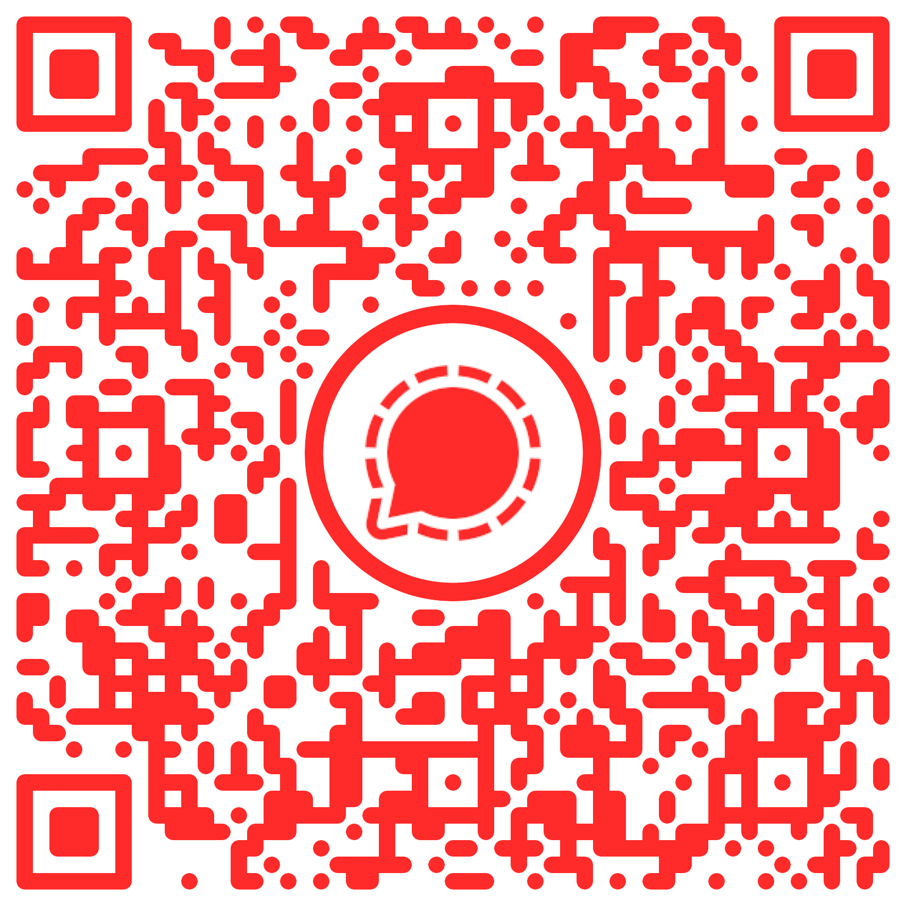

    

# Ashen Documentation and Website

This repository contains the sources for the Ashen and Yanartas projects' documentation and website at
[https://ashen.yasec.de/](https://ashen.yasec.de). 

Content is written in RestructuredText format in content/, and is compiled into a static HTML site using hugo.
`ashen.yasec.de` is currently built in CI on codeberg.

For discussion and short questions that aren't an issue, please use our [signal
group](https://signal.group/#CjQKIF-_tl1MNxwXSaVg2Xi_6NgXUXnlBl_XCNJKdRSO4E_6EhCX_xbVzbdy3qQLIhmlZ6tO) (also at the qr
code below).

## License

This documentation is licensed [CC-BY-SA 4.0](https://creativecommons.org/licenses/by-sa/4.0/).

